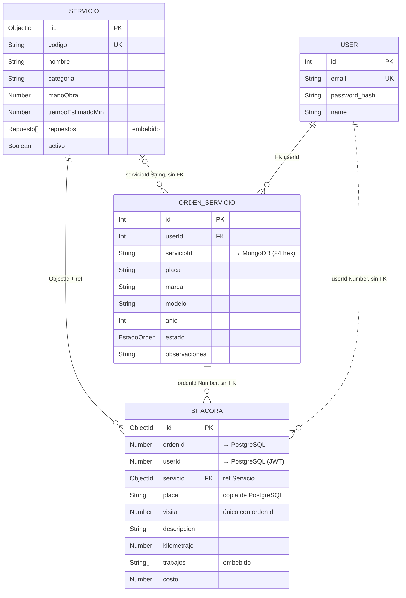
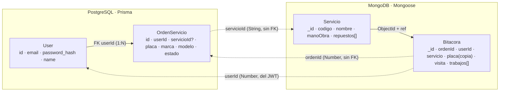

# Tarea individual U2 · Modelo híbrido PostgreSQL + MongoDB

**Estudiante:** Valeria Guaiguacundo  **N.º de lista:** 5  **Caso:** 5 · Taller mecánico

> Mismo formato que el workload del material de Modelado (lección 2.2) y que el ejemplo resuelto de la clínica
> (`docs/ejemplo_clinica/Workload_clinica_hibrida.md`). Cada operación agrega la fila **Base**.

## 1. Workload

### 1.1 Casos de uso
- Un taller mecánico atiende a unos 150 clientes que dejan su vehículo para un servicio (cambio de aceite, frenos, alineación…).
- El cliente abre una **orden de servicio** eligiendo un servicio del catálogo, y la orden pasa por estados (recibida, en diagnóstico, en reparación, lista, entregada o cancelada).
- En cada visita del vehículo se anota una **entrada de bitácora** (qué se hizo, kilometraje, costo). La bitácora crece en cada visita.
- Los clientes consultan el catálogo, sus órdenes y el historial de la bitácora de cada orden.
- El administrador mantiene el catálogo de servicios.

### 1.2 Datos principales (cuántos actores, cuántos registros, cuánto tiempo se guardan)
- Clientes (usuarios): ~150 (crecen ~10 por mes).
- Servicios del catálogo: ~40.
- Órdenes de servicio: ~25 por día (~9 000 al año).
- Entradas de bitácora: ~3 por orden, es decir ~75 por día. **Crecen sin límite**: ~137 000 en 5 años.
- Período: órdenes y bitácora se guardan 5 años (historial y garantía del vehículo).

### 1.3 Suposiciones (lo que puede cambiar)
- Una orden pertenece a un solo cliente y apunta a un solo servicio del catálogo.
- Cada servicio tiene repuestos distintos (un cambio de aceite lleva aceite y filtro; una alineación no lleva repuestos): la forma del documento cambia de un servicio a otro.
- El catálogo cambia pocas veces al mes, pero se lee muchísimo más de lo que se escribe.
- La placa del vehículo no cambia una vez abierta la orden: se puede copiar en la bitácora.
- Una orden tiene una sola entrada de bitácora por número de visita (visita 1, 2, 3…).
- No se debe borrar un servicio que alguna orden esté usando.

### 1.4 Operaciones (mínimo 6, una tabla por operación)

| Actor: | Cliente (o visitante) |
|---|---|
| Descripción: | Consulta el catálogo de servicios del taller, buscando por nombre y ordenando por precio |
| Tipo de operación: | Lectura |
| Datos en la operación: | codigo, nombre, categoria, manoObra, tiempoEstimadoMin, repuestos[] |
| Frecuencia: | Cada vez que alguien entra a pedir un servicio |
| Tasa: | ~800 / día |
| Base: | **MongoDB** (el servicio es un documento con sus repuestos embebidos: una sola lectura) |

| Actor: | Cliente |
|---|---|
| Descripción: | Crea una orden de servicio: elige el servicio del catálogo e indica la placa, marca y modelo de su vehículo |
| Tipo de operación: | Escritura |
| Datos en la operación: | servicioId, placa, marca, modelo, anio, observaciones; userId del JWT |
| Frecuencia: | Una por visita al taller |
| Tasa: | ~25 / día, con picos a las 8:00 |
| Base: | **PostgreSQL** (la orden tiene estado y es transaccional); lee MongoDB para comprobar que el `servicioId` exista y esté activo |

| Actor: | Cliente |
|---|---|
| Descripción: | Ve sus órdenes con el nombre, la categoría y el tiempo estimado del servicio de cada una |
| Tipo de operación: | Lectura |
| Datos en la operación: | ordenes (PostgreSQL) + codigo, nombre, categoria, tiempoEstimadoMin (MongoDB) |
| Frecuencia: | Cada cliente activo, ~1 vez al día |
| Tasa: | ~150 / día |
| Base: | **Las dos**: se unen en el servicio con `$in` + `Map` (2 consultas, sin N+1) |

| Actor: | Cliente |
|---|---|
| Descripción: | Avanza o cancela el estado de su orden (RECIBIDA → EN_DIAGNOSTICO → EN_REPARACION → LISTA → ENTREGADA) |
| Tipo de operación: | Escritura |
| Datos en la operación: | ordenId, estado nuevo |
| Frecuencia: | Unas 2 o 3 veces por orden |
| Tasa: | ~60 / día |
| Base: | **PostgreSQL** (estado con transiciones válidas; si dos cambios chocan, gana la regla de la tabla de transiciones) |

| Actor: | Cliente (dueño de la orden) |
|---|---|
| Descripción: | Registra una entrada de bitácora en cada visita: descripción, kilometraje, trabajos hechos y costo |
| Tipo de operación: | Escritura |
| Datos en la operación: | ordenId, descripcion, kilometraje, trabajos[], costo, visita; userId del JWT; placa copiada de PostgreSQL |
| Frecuencia: | Una por visita; ~3 por orden |
| Tasa: | ~75 / día (~137 000 en 5 años: crece sin límite) |
| Base: | **MongoDB**, colección aparte; lee PostgreSQL para comprobar que la orden exista (404) y sea del usuario (403) |

| Actor: | Cliente (dueño de la orden) |
|---|---|
| Descripción: | Lee el historial de la bitácora de su orden (visita más reciente primero) con el resumen: visitas, costo total, costo promedio y kilometraje máximo |
| Tipo de operación: | Lectura |
| Datos en la operación: | entradas de bitácora + servicio (populate) + resumen (aggregate) |
| Frecuencia: | Al abrir el detalle de una orden |
| Tasa: | ~200 / día |
| Base: | **MongoDB** solamente (por eso se copia la `placa`) |

| Actor: | Administrador |
|---|---|
| Descripción: | Crea o edita un servicio del catálogo (repuestos, tiempo, mano de obra) |
| Tipo de operación: | Escritura |
| Datos en la operación: | todos los campos del servicio |
| Frecuencia: | Pocas veces al mes |
| Tasa: | ~8 / mes |
| Base: | **MongoDB** (la forma cambia: cada servicio lleva repuestos distintos) |

| Actor: | Administrador |
|---|---|
| Descripción: | Elimina un servicio del catálogo |
| Tipo de operación: | Escritura |
| Datos en la operación: | _id; conteo de órdenes que lo usan |
| Frecuencia: | Casi nunca |
| Tasa: | ~1 / año |
| Base: | **MongoDB**, consultando PostgreSQL (409 si hay órdenes que lo usan; si no, borra sus bitácoras en cascada) |

### 1.5 Entidades

- **PostgreSQL**
  - User
    - OrdenServicio (1:N, FK `userId`)
- **MongoDB**
  - Servicio
    - repuestos[] (embebido)
    - Bitacora (1:N, `servicio` ObjectId + ref)
  - Bitacora
    - trabajos[] (embebido)
- **Entre bases (sin FK)**
  - OrdenServicio.servicioId → Servicio._id (String)
  - Bitacora.ordenId → OrdenServicio.id (Number, único junto con `visita`)
  - Bitacora.userId → User.id (Number, sale del JWT) · Bitacora.placa (copia de OrdenServicio.placa)

### 1.6 Observaciones (qué domina: lectura o escritura, qué crece sin límite, qué necesita integridad)
- Domina la **lectura**: ~1 150 lecturas por día (catálogo, mis órdenes, historial) frente a ~170 escrituras, unas 7 lecturas por cada escritura.
- Lo que **crece sin límite** es la bitácora: va en su propia colección y nunca embebida en el servicio ni en la orden (límite de 16 MB por documento).
- Lo que **necesita integridad** es la orden: su estado solo avanza por transiciones válidas y siempre pertenece a un usuario real (FK). Por eso se queda en PostgreSQL.
- El catálogo cambia de forma entre servicios (repuestos variables): encaja en documentos de MongoDB.
- Índices que pide el workload: `OrdenServicio.servicioId` y `(userId, createdAt)` (PostgreSQL); `bitacoras { ordenId: 1, visita: 1 }` único, `bitacoras { servicio: 1, fecha: -1 }`, `servicios { codigo: 1 }` único y `servicios { categoria: 1, nombre: 1 }` (MongoDB).

## 2. ¿PostgreSQL o MongoDB?

| Entidad | ¿Transacciones o choques? | ¿Otras dependen por FK? | ¿Forma variable? | ¿Crece sin límite? | ¿Se lee mucho más? | Base |
|---|---|---|---|---|---|---|
| User | Sí: el email no se repite | Sí: `OrdenServicio.userId` | No | No (~10 por mes) | No | **PostgreSQL** |
| OrdenServicio | Sí: estado con transiciones válidas | Sí: depende de User por FK | No: columnas fijas | No (~9 000 al año) | No: se lee y se escribe parecido | **PostgreSQL** |
| Servicio | No: cambia ~8 veces al mes | No por FK (la orden guarda su `_id` sin FK) | **Sí**: cada servicio con repuestos distintos | No (~40) | **Sí**: ~800 lecturas al día | **MongoDB** |
| Bitacora | No: solo se agregan entradas | No | Algo: trabajos[] y kilometraje opcionales | **Sí**: ~75 al día, sin tope | Sí: se lee por orden | **MongoDB** |

## 3. Relaciones dentro de MongoDB: embeber o referenciar

| Relación | Cardinalidad | ¿Se lee junto? | ¿Cambia seguido? | ¿Crece sin límite? | Decisión |
|---|---|---|---|---|---|
| Servicio → repuestos | 1:pocos (máx. 20) | Sí: siempre con el servicio | No | No | **Embeber** `repuestos: [{ nombre, cantidad, costoUnitario }]` |
| Servicio → Bitacora | 1:muchos | No: se lee por orden, no por servicio | Sí: entra una por visita | **Sí** | **Referenciar** (`servicio` ObjectId + `ref`, colección aparte) |
| Bitacora → trabajos | 1:pocos (máx. 15) | Sí: con su entrada | No | No | **Embeber** `trabajos: [String]` |

## 4. ERD híbrido (notación pata de gallo, como el material 2.1)

Dos zonas, PostgreSQL y MongoDB. Línea continua: FK de PostgreSQL o `ref` de Mongoose. **Línea punteada: referencia entre bases** (sin FK).
Imágenes: `docs/ERD_taller_hibrido.png` (pata de gallo) y `docs/ERD_taller_zonas.png` (dos zonas). Código Mermaid (GitHub lo dibuja solo):

Vista por zonas (qué vive en cada base y qué referencias cruzan):

## 5. Referencias

| Referencia | Se guarda como | La garantiza | Se une con |
|---|---|---|---|
| `OrdenServicio.userId` → `User.id` | `Int` con FK (`onDelete: Restrict`) | **PostgreSQL** (la FK) | `where: { userId }` de Prisma |
| `OrdenServicio.servicioId` → `Servicio._id` | `String?` de 24 hex, **sin FK** | **El servicio** `orden.service.js`: `isValidObjectId` + `findById` al crear (400/404/409); `servicio.service.js` al borrar (409 si hay órdenes) | `Servicio.find({ _id: { $in: ids } })` + `Map` en el servicio |
| `Bitacora.ordenId` → `OrdenServicio.id` | `Number`, **sin FK** | **El servicio** `cargarOrdenPropia`: la orden existe (404) y es del usuario del token (403); índice único `{ ordenId, visita }` | filtro `{ ordenId }`; al borrar la orden se hace `deleteMany({ ordenId })` |
| `Bitacora.userId` → `User.id` | `Number`, **sin FK** | **El JWT**: sale del token, nunca del cuerpo de la petición | no se une: se guarda para saber quién anotó |
| `Bitacora.servicio` → `Servicio._id` | `ObjectId` + `ref: "Servicio"` | **Mongoose** (tipo `ObjectId`); el valor se toma de la orden, no del cliente | `populate("servicio", "codigo nombre categoria")` |

## 6. Dato copiado entre bases (desnormalización)

- Dato: `placa` (de `OrdenServicio.placa` en PostgreSQL a `Bitacora.placa` en MongoDB).
- Por qué (operación del workload): la operación 6 (leer el historial de una orden, ~200 veces al día) muestra "Visita 2 · ABC-123" y se resuelve **solo con MongoDB**, sin consultar PostgreSQL por cada lectura. La placa no cambia durante la vida de la orden.
- Costo: ~10 bytes por entrada (~1,4 MB en 137 000 entradas). Si la placa de una orden se corrigiera, las entradas viejas conservarían la anterior; hoy la API no permite editar la placa, así que el riesgo es nulo y, si algún día se permite, habría que actualizar la bitácora con `updateMany({ ordenId })`.

## 7. Endpoints

| Método y ruta | Base(s) | Respuestas posibles |
|---|---|---|
| `POST /api/auth/register` | PostgreSQL | 201, 400, 409 (email repetido) |
| `POST /api/auth/login` | PostgreSQL | 200 (token), 401 |
| `GET /api/auth/me` · `DELETE /api/auth/me` | PostgreSQL | 200, 401 · DELETE: 409 si tiene órdenes |
| `POST /api/servicios` 🔒 | MongoDB | 201, 400, 401, 409 (código repetido) |
| `GET /api/servicios?q=&categoria=&fields=&sort=&page=&limit=` | MongoDB | 200, 400 |
| `GET /api/servicios/:id` | MongoDB | 200, 400 (id inválido), 404 |
| `PUT /api/servicios/:id` 🔒 | MongoDB (`findById` + `save`) | 200, 400, 401, 404, 409 |
| `DELETE /api/servicios/:id` 🔒 | MongoDB + PostgreSQL | 200 (borra bitácoras en cascada), 401, 404, **409 si PostgreSQL lo usa** |
| `POST /api/ordenes` 🔒 | PostgreSQL + MongoDB (valida) | 201, 400, 401, **404 (servicio no existe)**, 409 (servicio inactivo) |
| `GET /api/ordenes?estado=` 🔒 | PostgreSQL + MongoDB (`$in` + `Map`) | 200, 400, 401 |
| `GET /api/ordenes/:id` 🔒 | PostgreSQL + MongoDB | 200, 400, 401, 403, 404 |
| `PATCH /api/ordenes/:id/estado` 🔒 | PostgreSQL | 200, 400, 401, 403, 404, 409 (transición inválida) |
| `DELETE /api/ordenes/:id` 🔒 | PostgreSQL + MongoDB (cascada) | 200, 401, 403, 404, 409 (solo RECIBIDA o CANCELADA) |
| `POST /api/ordenes/:ordenId/bitacora` 🔒 | MongoDB validando PostgreSQL | 201, 400, 401, **403 (orden ajena)**, **404 (orden no existe)**, **409 (visita repetida por E11000)** o orden cerrada |
| `GET /api/ordenes/:ordenId/bitacora?sort=` 🔒 | MongoDB (populate + aggregate) | 200, 400, 401, 403, 404 |

🔒 = exige `Authorization: Bearer <token>`.

## 8. ¿Qué pasa si una de las dos bases falla a la mitad?

No hay una transacción que cubra las dos bases, así que el orden de las operaciones decide qué puede quedar mal:

- **Crear orden** (lee MongoDB y luego escribe en PostgreSQL): si MongoDB falla, la lectura de validación falla antes de escribir y la API responde **503** sin guardar nada. Si PostgreSQL falla después de validar, no se creó la orden y no hay nada que deshacer.
- **Crear entrada de bitácora** (lee PostgreSQL y luego escribe en MongoDB): si PostgreSQL falla, no se escribe nada. Si MongoDB falla al guardar, la orden queda intacta y simplemente no hay entrada.
- **Borrar orden** (PostgreSQL y luego su bitácora en MongoDB): si MongoDB falla después de borrar la orden, quedan entradas de bitácora huérfanas. Es el mal menor (mejor que perder el historial de una orden que sigue existiendo); esas entradas se limpian al borrar el servicio (`deleteMany({ servicio })`).
- **Borrar servicio** (cuenta en PostgreSQL, borra bitácoras y servicio en MongoDB): si PostgreSQL falla, no se borra nada. Hay una pequeña ventana entre el conteo y el borrado en la que otra persona podría crear una orden para ese servicio; con un solo taller y ~1 borrado al año se acepta ese riesgo.
- `src/db/mongo.js` usa `bufferCommands = false` y `serverSelectionTimeoutMS = 5000`: cuando MongoDB cae, la API falla rápido (503) en vez de quedarse colgada. El servidor solo arranca si MongoDB conecta.
